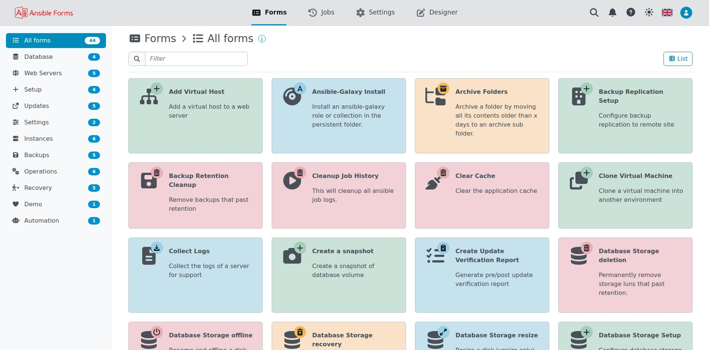

  <picture>
    <source media="(prefers-color-scheme: dark)" srcset="logo_dark.svg">
    
  </picture>

  <h3>Self-service forms for your Ansible playbooks and automation templates.</h3>

  

  <a href="https://ansibleforms.com">Website</a> •
  <a href="https://ansibleforms.com/en/installation/">Install</a> •
  <a href="https://github.com/ansibleforms/ansibleforms">Main repository</a> •
  <a href="https://github.com/ansibleforms/ansibleforms/releases/latest">Latest release</a>

Your playbooks already know how to do the work; AnsibleForms lets the rest of your team ask for it.
Describe a form in YAML, fill its dropdowns from databases, REST APIs and expressions, and every
submission becomes the extravars of an Ansible playbook or an AWX/AAP/Ascender template, with approvals,
schedules and a full job history along the way.

Open source, self-hosted, and documented at [ansibleforms.com](https://ansibleforms.com).

## Highlights

- Cascaded dropdowns fed by databases, REST APIs and expressions, with field dependencies
- Multi-step forms, approvals, email notifications and one-off or recurring schedules
- Role-based access with local, LDAP, Azure AD and OIDC logins
- Forms kept in Git, a built-in designer, and a REST API with interactive docs
